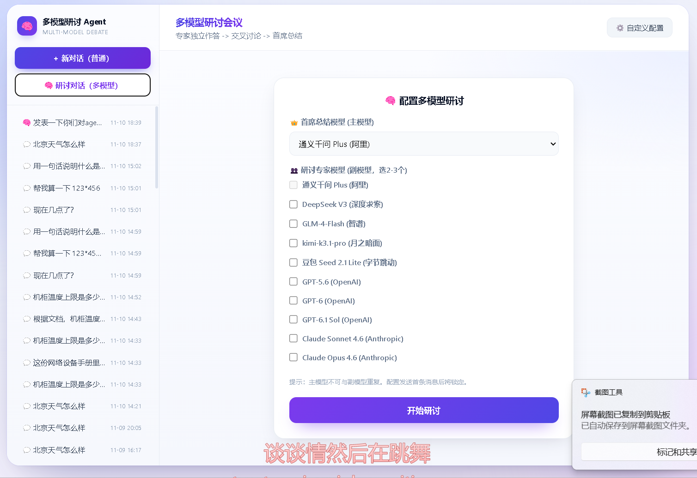
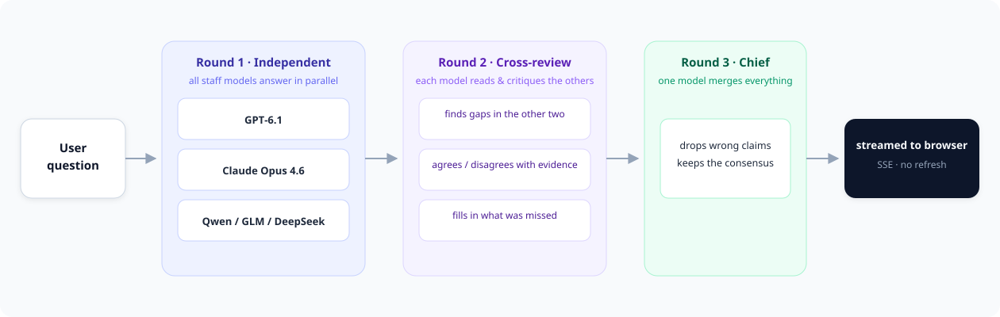

<div align="center">

# Multi-Model Agent Debate

### 让多个大模型先各自作答，再互相挑错，最后由首席模型总结

<sub>Multi-model debate for LLMs — independent answers, cross-review, then a chief model synthesizes.</sub>

一套开箱即用的**多模型研讨 Agent**：LangGraph 编排 · Hybrid RAG 检索（BM25 + FAISS + 精排）· Word / PDF 直接问答 · SSE 流式输出 · 多会话持久化


<sub><a href="#-快速开始">快速开始</a> · <a href="#-工作原理">工作原理</a> · <a href="#-功能一览">功能</a> · <a href="#-配置模型不用改代码">配置模型</a> · <a href="#-常见问题">常见问题</a> · <a href="#english">English</a></sub>

</div>

---



## 💡 为什么不是"再问一遍同一个模型"

让一个模型检查自己的答案，效果很有限——**它很难推翻自己**。同一个模型、同一套权重、同一批偏见，复查十遍也是同一个盲区。

这个项目换了个思路：

> 让 GPT、Claude、Qwen、DeepSeek **同时回答**同一个问题，然后让它们**互相阅读对方的答案并挑错**，最后由一个首席模型汇总。

不同厂商、不同训练数据带来的分歧，恰好是最有价值的部分——分歧出现的地方，往往就是原答案最不可靠的地方。

```text
用户提问
   ├─ 第一轮：N 个专家模型并行独立作答（互不可见）
   ├─ 第二轮：每个专家读到其他专家的观点，补充或反驳
   └─ 第三轮：首席模型去伪存真，输出一份最终结论
```

## 🔬 工作原理



| 阶段 | 做什么 | 关键点 |
| --- | --- | --- |
| 第一轮 · 独立作答 | 所有副模型并行回答，彼此看不到对方 | 保证观点的**独立性**，避免互相抄 |
| 第二轮 · 交叉研讨 | 每个模型读到其他模型的答案，指出漏洞或补充 | 暴露单模型的**认知盲区** |
| 第三轮 · 首席总结 | 主模型综合所有观点，剔除错误信息 | 输出**一份**结构化的最终结论 |

三个阶段的内容按轮次分块独立渲染，**后一轮不会顶掉前一轮**；整个研讨过程通过 SSE 实时推送到浏览器，刷新页面后从数据库完整还原（专家头像、模型名、每轮气泡都在）。

## ✨ 功能一览

| | 能力 | 说明 |
| --- | --- | --- |
| 🗣️ | **多模型研讨** | 主模型 + 任意数量副模型，三阶段交叉验证，可随时更换阵容 |
| 🧭 | **模型分层路由** | 按任务复杂度自动挑档位：翻译/摘要走免费模型，代码/方案走强模型；默认关闭，带 `auto_route` 开关。**实测 16 个任务省 13.6%，质量降 3.8%** |
| 📄 | **文档问答** | 前端直接上传 `.docx` / `.pdf` / `.txt`，Word 用标准库解析（不额外装依赖），PDF 逐页抽取并标注页码；**单模型和研讨模式都支持** |
| 🔍 | **三阶段 RAG** | Query 改写 → BM25 + FAISS 双路召回 → Cross-Encoder 精排，专治专有名词检索不到 |
| ⚡ | **并发工具调用** | 一次问"北京、上海、厦门天气"，`ThreadPoolExecutor` 并发请求三个接口 |
| 🧠 | **意图前置路由** | 时间/计算等确定性场景走后端兜底，不依赖模型自觉调工具 |
| 🌐 | **联网搜索** | 集成博查搜索，可强制开启，也可由模型自主判断是否联网 |
| 🔐 | **无状态多模型透传** | 前端填自己的 API Key 即可切换厂商，`contextvars` 请求级隔离，服务端零存储 |
| 💻 | **SSE 流式体验** | 思考链路 + 最终回答双通道打字机输出，支持实时中断 |
| 📊 | **全链路 Trace** | 每个请求一个 Trace ID，线程池里的日志也不会丢 |
| 🛡️ | **鉴权与限流** | API Key 校验 + SlowAPI 单 IP 限流 + 工具错误自愈重试 |

内置 10 个模型可直接使用：通义千问、DeepSeek、智谱 GLM、Kimi、豆包 Seed、GPT-5.6、GPT-6、GPT-6.1、Claude Sonnet 4.6、Claude Opus 4.6。

## 🚀 快速开始

### 1. 安装依赖

```bash
pip install -r requirements.txt
```

### 2. 配置密钥

把根目录的 `env.txt` 复制成 `.env`，把里面 `sk-REPLACE_ME` 换成你自己的 Key。**只想先跑起来的话，配一个模型就够了**：

```env
MODEL_REGISTRY={"qwen-plus":{"base_url":"https://dashscope.aliyuncs.com/compatible-mode/v1","api_key":"sk-你的key","vendor":"阿里","label":"通义千问 Plus"}}
DEFAULT_MODEL_ID=qwen-plus
API_KEY=my-secret-key-123
```

### 3. 启动

```bash
python run.py
```

或者用 Docker（多阶段构建，一条命令）：

```bash
docker compose up -d --build
```

### 4. 打开页面

- 前端：<http://127.0.0.1:8000>
- 接口文档：<http://127.0.0.1:8000/docs>

> 首次启动会下载 Embedding 和 Reranker 模型（约 400MB），需要几分钟；之后是秒级冷启动。

## 🔌 配置模型（不用改代码）

所有模型都来自 `.env` 里的 `MODEL_REGISTRY`——**一段单行 JSON**。想加一个模型，往里追加一段就行：

```json
"doubao-seed-2-1-lite":{
  "base_url":"https://ark.cn-beijing.volces.com/api/v3",
  "api_key":"你的火山方舟 ARK_API_KEY",
  "vendor":"字节跳动",
  "label":"豆包 Seed 2.1 Lite",
  "model":"doubao-seed-2-1-lite-260915",
  "extra_body":{"thinking":{"type":"disabled"}}
}
```

重启后，下拉框和多模型研讨的模型列表里就会自动出现，**不需要改任何后端代码**。

- `model`（可选）：真正发给厂商的模型 ID。不写的话，registry 里的 key 会直接当模型名用。
- `extra_body`（可选）：原样追加到请求体。上面的例子里，豆包 Seed 2.1 默认开启**深度思考**，一次简单问答要 20~60 秒甚至直接超时；关掉之后同样的问题 1~2 秒返回。
- 想让它默认被选中：改 `static/index.html` 里的 `DEFAULT_MODEL_ID`。

只要厂商兼容 OpenAI 协议（`/chat/completions` + `tools`），就能接进来——OpenAI、Anthropic 中转、DeepSeek、Kimi、智谱、通义、火山方舟都验证过。

<details>
<summary><b>🛠 技术栈</b></summary>

- **核心框架**：FastAPI + Uvicorn + SQLAlchemy
- **Agent 编排**：LangGraph (StateGraph) + ReAct + ThreadPoolExecutor 并发
- **RAG**：FAISS + BM25 + Jieba + HuggingFace Embedding + BAAI/bge-reranker 精排
- **联网搜索**：Bocha AI Web Search API
- **安全**：SlowAPI 限流 + 自定义 API Key 鉴权 + SSRF 白名单
- **存储**：SQLite（WAL 模式）+ 内存缓存
- **前端**：原生 HTML/JS + SSE 流式渲染，零构建步骤
- **部署**：Docker 多阶段构建 + Docker Compose

</details>

<details>
<summary><b>📁 项目结构</b></summary>

```text
multi-model-agent-debate/
├── app/
│   ├── api/          # 路由层：鉴权、意图拦截、流式接口、多会话查询
│   ├── agent/        # 核心层：LangGraph 状态机、LLM 节点、并发 Tool 节点
│   ├── core/         # 基础层：配置、Trace 日志、LLM 工厂、错误翻译
│   ├── db/           # 数据层：SQLite 模型、CRUD、向量库（FAISS + BM25 + 精排）
│   ├── middleware/   # 中间件：API Key 鉴权与 IP 限流
│   └── tools/        # 工具层：天气、计算、时间、RAG 检索、联网搜索、文档解析
├── knowledge/        # 本地知识库（.txt / .md / .pdf）
├── static/           # 前端页面（多会话 + 流式打字机 + 文档上传）
├── docs/             # README 用的图
├── Dockerfile
├── docker-compose.yml
├── requirements.txt
└── run.py            # 启动入口
```

</details>

<details>
<summary><b>🧩 几个值得一看的实现细节</b></summary>

**意图前置路由**：时间、计算这类确定性场景，先用正则拦截并直接调用后端工具，不让模型去猜"该不该调工具"；同时在 LLM 节点动态切换 `tool_choice`（首次 `required` 强制，二次 `auto` 放开），既解决"幻觉不调工具"，也解决"工具无限死循环"。

**两阶段混合检索**：Query 改写把口语化提问压成检索关键词 → BM25 + FAISS 双路召回 → RRF 融合 → Cross-Encoder 对 Top10 精排 → 取 Top3 送进上下文，专门对付专有名词召回率低和"中间迷失"。

**工具错误自愈**：工具抛错时不直接失败，而是把错误信息回流给模型，引导它修正参数重试（最多 2 次）。

**并发下的上下文**：`contextvars` 存 Trace ID 和 LLM 客户端，线程池里再包一层上下文传递，保证并发调用时日志和密钥不会串。

</details>

<details>
<summary><b>⚠️ 下载模型卡住怎么办（国内网络）</b></summary>

首次启动会从 HuggingFace 拉取 `all-MiniLM-L6-v2` 和 `bge-reranker-base`。如果卡在"正在加载向量模型"，用镜像：

```env
HF_ENDPOINT=https://hf-mirror.com
```

已经下载过的话，直接离线运行：

```env
HF_HUB_OFFLINE=1
```

</details>

## 🧭 模型分层路由（按任务挑模型）

不是所有问题都值得用最贵的模型。开启后，请求会按任务复杂度自动选择档位：

| 档位 | 典型任务 | 候选模型（取注册表里第一个存在的） |
| --- | --- | --- |
| `cheap` | 翻译、改写、格式化、摘要、短问答 | GLM-4-Flash、豆包 Seed Lite |
| `mid` | 一般讨论、开放问答 | DeepSeek、Kimi |
| `strong` | 代码、架构、方案设计、长文分析、带文档问答 | GPT-6.1、Claude Opus、GPT-6 |

**刻意保守的地方**：天气、时间、联网搜索这类依赖 function calling 的请求**不接管**，
继续用用户当前选的模型——弱模型调错工具参数的代价，比省下的那点钱大得多。

### 开启方式

```env
AUTO_ROUTE=true
USAGE_LOG_PATH=data/usage.jsonl
```

请求里带 `auto_route: true` 才生效；显式指定了模型的请求永远以用户选择为准：

```bash
curl -X POST http://127.0.0.1:8000/chat \
  -H "Content-Type: application/json" -H "X-API-Key: my-secret-key-123" \
  -d '{"message":"把这段话翻译成英文：你好","auto_route":true}'
```

响应里的 `routed_model` 会告诉你这一轮实际用了哪个模型。

### 算账

每次模型调用都会往 `data/usage.jsonl` 追加一行（tokens / 成本 / 延迟 / 档位），
用它可以算出真实开销：

```json
{"trace_id":"0bd4e2e9","model":"glm-4-flash","tier":"cheap","prompt_tokens":1344,"completion_tokens":15,"latency_ms":2228,"cost_usd":0.0}
```

同一批任务分别跑「关路由」和「开路由」：

```bash
python scripts/benchmark_route.py --base http://127.0.0.1:8000
```

### 实测结果

同一批 16 个任务，A 组全部用 `gpt-6.1-sol`，B 组开启路由：

| 指标 | 全部用强模型 | 开启路由 | 变化 |
| --- | --- | --- | --- |
| 16 个任务总成本 | \$0.2217 | \$0.1915 | **−13.6%** |
| 平均质量打分（10 分制） | 8.25 | 7.94 | −3.8% |
| 走免费模型的任务 | 0 | 7 / 16 | — |
| 强模型任务占总成本 | 100% | **81.7%** | — |

**结论比降幅本身更重要**：7 条简单任务占了请求数的 44%，却只占总成本的 **12.6%**。
真正烧钱的 7 条强模型任务（架构、长文、方案、代码……）路由一分钱也省不了。

> 降本的上限由 **token 结构**决定，不由**请求数量**决定。
> 想真省钱，不是换更便宜的模型，而是让强模型少写废话。

质量损失也很集中：16 条里 13 条完全持平，掉分的是翻译成日文（弱模型出现中日混写）、
闲聊和改写各差 1 分。**风险是集中的，不是均匀分布的**——所以按任务类型开关，
比全局一把梭更实用。

价格表在 [`app/core/router.py`](app/core/router.py) 的 `MODEL_PRICE_PER_M`，按自己的实际账单改。

## ❓ 常见问题

**Q：豆包/思考类模型很慢，老是超时？**
在 registry 里加 `"extra_body":{"thinking":{"type":"disabled"}}` 关掉深度思考，或者把 `.env` 里的 `LLM_TIMEOUT` 调大（默认 60 秒）。

**Q：研讨模式点了没反应 / 历史记录里只剩一段文字？**
研讨过程会逐条写库（每条发言单独一行），刷新或切换会话都能还原成专家气泡。**这次改动之前产生的旧会话仍是拼接文本**，属于历史数据格式差异。

**Q：`python-multipart` 装不上，上传功能还能用吗？**
能。文档上传走的是 base64 JSON 通道，不依赖 `python-multipart`。

**Q：能不能只用本地模型？**
只要它兼容 OpenAI 协议（vLLM、Ollama、LM Studio 都行），在 registry 里把 `base_url` 指过去即可。

## 📄 License

[MIT](LICENSE) © 2026

---

<a id="english"></a>

## English

**Multi-Model Agent Debate** — a LangGraph + FastAPI agent where several LLMs answer independently, cross-review each other's answers, and a chief model synthesizes the final response.

- 🗣️ Debate mode: Round 1 independent answers → Round 2 cross-critique → Round 3 chief summary
- 📄 Ask questions about your `.docx` / `.pdf` (works in both single-model and debate mode)
- 🔍 Hybrid RAG: query rewrite → BM25 + FAISS → Cross-Encoder rerank
- ⚡ Parallel tool calling, SSE streaming, multi-session persistence
- 🔌 Add any OpenAI-compatible model by editing one JSON line — no code changes

```bash
cp env.txt .env   # fill in your API keys
pip install -r requirements.txt
python run.py     # http://127.0.0.1:8000
```

</div>
