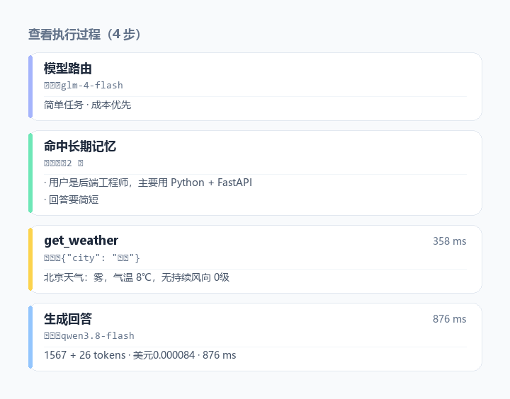

<div align="center">

# Multi-Model Agent Debate

### Several LLMs answer on their own, critique each other, then a chief model writes the final answer

<sub>A ready-to-run multi-model debate agent: LangGraph orchestration · Hybrid RAG (BM25 + FAISS + reranking) · direct Word / PDF Q&A · SSE streaming · persistent sessions</sub>


<sub><b>English</b> · <a href="README.zh-CN.md">中文</a></sub>

<sub><a href="#-quick-start">Quick start</a> · <a href="#-how-it-works">How it works</a> · <a href="#-what-the-agent-actually-did">Execution trace</a> · <a href="#-memory-that-survives-the-conversation">Memory</a> · <a href="#-features">Features</a> · <a href="#-configure-models-without-touching-code">Model config</a> · <a href="#-faq">FAQ</a></sub>

</div>

---


## 💡 Why not just ask the same model twice

Asking a model to check its own answer rarely works — **it can hardly overturn itself**. Same weights, same blind spots; re-reading it ten times lands on the same gap.

This project takes a different route:

> Let GPT, Claude, Qwen and DeepSeek **answer the same question at the same time**, then have them **read each other's answers and look for flaws**, and finally a chief model synthesizes the result.

The disagreements that come from different vendors and different training data are the valuable part — wherever the answers diverge is usually where the original answer is least reliable.

```text
user question
   ├─ round 1: N expert models answer independently (they cannot see each other)
   ├─ round 2: each expert reads the others and adds to them or pushes back
   └─ round 3: the chief model drops what is wrong and writes one final answer
```

## 🔬 How it works


| Stage | What happens | Why it matters |
| --- | --- | --- |
| Round 1 · independent answers | All staff models answer in parallel, blind to each other | Keeps the views **independent**, so nobody copies a neighbour |
| Round 2 · cross-review | Each model reads the others and points out holes or adds detail | Surfaces each single model's **blind spot** |
| Round 3 · chief summary | The chief model merges everything and removes what is wrong | Produces **one** structured final answer |

Each round is rendered as its own block, **a later round never overwrites an earlier one**. The whole debate streams to the browser over SSE, and a page refresh restores it completely from the database (avatars, model names, every bubble).

### Two ways to run the panel

| Mode | What it does | When to use it |
| --- | --- | --- |
| **Debate** (default) | Independent answers → cross-review → chief summary | You want one answer you can trust |
| **Parallel compare** | Independent answers only, then a cheap model extracts **consensus / disagreements / one-offs** | You want to see *where the models disagree* — and it costs far less |

Parallel compare skips the review and summary rounds entirely: about **40% fewer model calls** than a full debate.

## 🔍 What the agent actually did

Most chat products hand you an answer and a footnote: *"generated by AI, for reference only."*

This one shows you the **decision** behind the answer. Every reply carries an execution trace you can open — which model was routed to and why, which memories were injected, which tools ran with what arguments, how long each took, and what the whole thing cost.



| Card | Appears when | What it tells you |
| --- | --- | --- |
| 🧭 **Route** | auto-routing took over | which tier was picked and which model served it |
| 🧠 **Memory** | long-term memory was hit | how many facts, and their first lines |
| ⚙ **Tool** | a tool was called | tool name, arguments, result, **duration** |
| ⚡ **Generate** | the model answered | real model ID, prompt + completion tokens, cost, latency |
| ⏱ **Fast path** | time or arithmetic question | which rule matched — **and that no model was called at all** |

Two things this makes visible that are usually hidden:

- **Cost per answer.** `1476 + 26 tokens · 0.000084 USD · 876 ms` — not an estimate from a pricing page, but the actual usage the vendor returned for that request.
- **When the model is not involved.** Deterministic questions (time, arithmetic) are answered by the backend in ~0 ms, and the trace says so: *"read the system clock, no model called, cost 0"*.

The trace is a structured SSE event (`steps`), not text scraped on the front end, so each card carries its own type, arguments, result and timing.

## 🧠 Memory that survives the conversation

Memory comes in two layers, and they are stored separately:

| Layer | Scope | Example |
| --- | --- | --- |
| **Session memory** | one conversation | "the city this user keeps asking about" |
| **User memory** | every conversation | "backend engineer, mostly Python + FastAPI, wants short answers" |

Session memory is the old behaviour. User memory is new: **start a fresh conversation and the agent still knows who it is talking to**.

What gets extracted is deliberately narrow — identity, tech stack, long-term preferences, and explicit "from now on do it this way" instructions. Task details, one-off context and secrets are excluded, because a memory table that fills up with yesterday's weather is worse than no memory at all.

Inspect and clear it without touching the database:

```bash
python scripts/show_memory.py          # what does it remember?
python scripts/show_memory.py --clear  # forget everything
```

> **A guard worth mentioning.** Weak models occasionally return a list of bullet points with no content (`- \n- \n- `). Written straight to the table, that silently wipes every fact the user ever had. Empty bullets are now filtered line by line, and if nothing survives, the old memory is kept untouched.

Both layers are merged into a single system message at request time, so the prompt does not grow an extra turn per memory type.

## ✨ Features

| | Capability | Description |
| --- | --- | --- |
| 🗣️ | **Multi-model debate** | One chief model + any number of staff models, three-stage cross-validation, line-up can be changed at any time |
| ⚡ | **Parallel compare** | Only round 1 (independent answers, no cross-review), then a cheap model extracts **consensus / disagreements / one-offs**; ~40% fewer model calls than a full debate |
| 🧭 | **Tiered model routing** | Picks a tier from task complexity: translation and summaries go to free models, code and design go to strong ones. Off by default, behind an `auto_route` flag. **Measured on 16 tasks: 13.6% cheaper, 3.8% quality drop** |
| 📄 | **Document Q&A** | Upload `.docx` / `.pdf` / `.txt` from the UI; Word is parsed with the standard library (no extra dependency), PDF is extracted page by page with page numbers. **Works in both single-model and debate mode** |
| 🔍 | **Three-stage RAG** | Query rewrite → BM25 + FAISS dual recall → Cross-Encoder rerank, aimed at proper nouns that plain vector search misses |
| ⚡ | **Parallel tool calls** | Ask "weather in Beijing, Shanghai and Xiamen" and three endpoints are hit concurrently via `ThreadPoolExecutor` |
| 🧠 | **Intent routing up front** | Deterministic cases (time, arithmetic) are handled by the backend instead of hoping the model decides to call a tool |
| 🌐 | **Web search** | Bocha search integration, either forced on or left to the model's judgement |
| 🔐 | **Stateless multi-model passthrough** | Users bring their own API keys; request-level isolation via `contextvars`, nothing stored server-side |
| 💻 | **SSE streaming** | Dual-channel typewriter output (reasoning + answer), with live interruption |
| 👁️ | **Execution trace** | Every answer opens a trace: routed model, memories injected, tool calls with arguments and durations, tokens, real cost — and explicitly when **no model was called** |
| 🗂️ | **Cross-session memory** | Two layers (session / user); a new conversation still knows your stack and preferences. Extract → filter empty bullets → merge, never overwrite with junk |
| 📊 | **End-to-end tracing** | One trace ID per request, surviving the thread pool |
| 🛡️ | **Auth and rate limiting** | API key check + SlowAPI per-IP limits + self-healing retries on tool errors |

Ten models ship with the registry: Qwen, DeepSeek, Zhipu GLM, Kimi, Doubao Seed, GPT-5.6, GPT-6, GPT-6.1, Claude Sonnet 4.6, Claude Opus 4.6.

## 🚀 Quick start

### 1. Install dependencies

```bash
pip install -r requirements.txt
```

### 2. Configure keys

Copy `env.txt` to `.env` and replace `sk-REPLACE_ME` with your own key. **One model is enough to get started**:

```env
MODEL_REGISTRY={"qwen-plus":{"base_url":"https://dashscope.aliyuncs.com/compatible-mode/v1","api_key":"sk-your-key","vendor":"Alibaba","label":"Qwen Plus"}}
DEFAULT_MODEL_ID=qwen-plus
API_KEY=my-secret-key-123
```

### 3. Start it

```bash
python run.py
```

Or with Docker (multi-stage build, one command):

```bash
docker compose up -d --build
```

### 4. Open the UI

- Front end: <http://127.0.0.1:8000>
- API docs: <http://127.0.0.1:8000/docs>

> The first start downloads the embedding and reranker models (~400MB) and takes a few minutes; after that cold start is seconds.

## 🔌 Configure models without touching code

Every model comes from `MODEL_REGISTRY` in `.env` — **a single line of JSON**. To add one, append an entry:

```json
"doubao-seed-2-1-lite":{
  "base_url":"https://ark.cn-beijing.volces.com/api/v3",
  "api_key":"your Volcengine Ark key",
  "vendor":"ByteDance",
  "label":"Doubao Seed 2.1 Lite",
  "model":"doubao-seed-2-1-lite-260915",
  "extra_body":{"thinking":{"type":"disabled"}}
}
```

Restart and it shows up in the dropdown and in the debate line-up — **no backend code changes**.

- `model` (optional): the real model ID sent to the vendor. If omitted, the registry key is used as the model name.
- `extra_body` (optional): appended to the request body verbatim. In the example above Doubao Seed 2.1 enables **deep thinking** by default, which turns one simple question into 20–60 seconds or a timeout; disabling it brings the same question down to 1–2 seconds.
- To make a model the default selection, edit `DEFAULT_MODEL_ID` in `static/index.html`.

Anything that speaks the OpenAI API (`/chat/completions` + `tools`) can be plugged in — OpenAI, Anthropic proxies, DeepSeek, Kimi, Zhipu, Qwen and Volcengine Ark are all verified.

<details>
<summary><b>🛠 Tech stack</b></summary>

- **Framework**: FastAPI + Uvicorn + SQLAlchemy
- **Agent orchestration**: LangGraph (StateGraph) + ReAct + `ThreadPoolExecutor` concurrency
- **RAG**: FAISS + BM25 + Jieba + HuggingFace embeddings + BAAI/bge-reranker
- **Web search**: Bocha AI Web Search API
- **Security**: SlowAPI rate limits + custom API key auth + SSRF allowlist
- **Storage**: SQLite (WAL mode) + in-memory cache
- **Front end**: plain HTML/JS with SSE rendering, no build step
- **Deployment**: multi-stage Docker build + Docker Compose

</details>

<details>
<summary><b>📁 Project layout</b></summary>

```text
multi-model-agent-debate/
├── app/
│   ├── api/          # routes: auth, intent interception, streaming, session queries
│   ├── agent/        # core: LangGraph state machine, LLM nodes, concurrent tool nodes
│   ├── core/         # foundation: config, trace logging, LLM factory, error translation
│   ├── db/           # data: SQLite models, CRUD, vector store (FAISS + BM25 + rerank)
│   ├── middleware/   # API key auth and per-IP rate limiting
│   └── tools/        # tools: weather, calculator, time, RAG retrieval, web search, doc parsing
├── knowledge/        # local knowledge base (.txt / .md / .pdf)
├── static/           # front end (sessions + typewriter streaming + document upload)
├── docs/             # images used by this README
├── Dockerfile
├── docker-compose.yml
├── requirements.txt
└── run.py            # entry point
```

</details>

<details>
<summary><b>🧩 Implementation details worth a look</b></summary>

**Intent routing up front.** Deterministic cases such as time and arithmetic are intercepted with a regex and answered by a backend tool, so the model never has to guess whether to call one. The LLM node also flips `tool_choice` dynamically (`required` on the first pass, `auto` afterwards), which fixes both "the model hallucinates instead of calling a tool" and "the tool loop never ends".

**Two-stage hybrid retrieval.** Query rewrite compresses a conversational question into search keywords → BM25 + FAISS dual recall → RRF fusion → Cross-Encoder reranks the top 10 → the top 3 go into context. This is aimed at low recall on proper nouns and at losing information in the middle of a long context.

**Self-healing tool errors.** A failing tool does not abort the request: the error text flows back to the model so it can fix its arguments and retry (up to twice).

**Context under concurrency.** Trace ID and LLM client live in `contextvars`, with the context handed into the thread pool, so concurrent calls never mix up logs or keys.

</details>

<details>
<summary><b>⚠️ Model download hangs (mainland China)</b></summary>

The first start pulls `all-MiniLM-L6-v2` and `bge-reranker-base` from HuggingFace. If it stalls at "loading embedding model", use a mirror:

```env
HF_ENDPOINT=https://hf-mirror.com
```

Already downloaded? Run fully offline:

```env
HF_HUB_OFFLINE=1
```

</details>

## 🧭 Tiered model routing

Not every question deserves the most expensive model. With routing on, each request picks a tier from task complexity:

| Tier | Typical tasks | Candidates (first one present in the registry wins) |
| --- | --- | --- |
| `cheap` | Translation, rewriting, formatting, summaries, short Q&A | GLM-4-Flash, Doubao Seed Lite |
| `mid` | General discussion, open questions | DeepSeek, Kimi |
| `strong` | Code, architecture, solution design, long analysis, document Q&A | GPT-6.1, Claude Opus, GPT-6 |

**Where it deliberately stays out of the way**: requests that depend on function calling — weather, time, web search — are **not** taken over; they keep the model the user selected. A weak model calling a tool with the wrong arguments costs far more than the money saved.

### Enabling it

```env
AUTO_ROUTE=true
USAGE_LOG_PATH=data/usage.jsonl
```

It only applies when the request carries `auto_route: true`; a request that names a model explicitly always wins:

```bash
curl -X POST http://127.0.0.1:8000/chat \
  -H "Content-Type: application/json" -H "X-API-Key: my-secret-key-123" \
  -d '{"message":"Translate into English: 你好","auto_route":true}'
```

The `routed_model` field in the response tells you which model actually ran.

### Keeping score

Every model call appends one line to `data/usage.jsonl` (tokens / cost / latency / tier), which is enough to compute real spend:

```json
{"trace_id":"0bd4e2e9","model":"glm-4-flash","tier":"cheap","prompt_tokens":1344,"completion_tokens":15,"latency_ms":2228,"cost_usd":0.0}
```

Run the same task batch with routing off and on:

```bash
python scripts/benchmark_route.py --base http://127.0.0.1:8000
```

### Measured results

16 identical tasks; group A always uses `gpt-6.1-sol`, group B has routing on:

| Metric | Always the strong model | Routing on | Change |
| --- | --- | --- | --- |
| Total cost, 16 tasks | $0.2217 | $0.1915 | **−13.6%** |
| Mean quality score (0–10) | 8.25 | 7.94 | −3.8% |
| Tasks on a free model | 0 | 7 / 16 | — |
| Cost share of strong-model tasks | 100% | **81.7%** | — |

**The conclusion matters more than the percentage**: seven simple tasks are 44% of all requests but only **12.6%** of total cost. The seven expensive tasks (architecture, long-form, solution design, code…) cannot be cut by routing at all.

> The ceiling on savings is set by **token structure**, not by **request count**.
> Saving real money is not about swapping in a cheaper model, it is about making the strong model write less.

The quality loss is concentrated too: 13 of 16 tasks are identical, and the ones that dropped are a Japanese translation (the weak model mixed in Chinese characters), small talk and rewriting, by one point each. **Risk clusters, it does not spread evenly** — which is why a per-task-type switch beats a global one.

The price table lives in `MODEL_PRICE_PER_M` in [`app/core/router.py`](app/core/router.py); adjust it to your own invoice.

## ❓ FAQ

**Q: Doubao and other thinking models are slow and keep timing out.**
Add `"extra_body":{"thinking":{"type":"disabled"}}` to the registry entry to turn deep thinking off, or raise `LLM_TIMEOUT` in `.env` (default 60 seconds).

**Q: Debate mode does nothing, or history shows one blob of text.**
Each debate utterance is written to the database as its own row, so a refresh or a session switch restores the expert bubbles. **Sessions created before that change are still concatenated text** — that is a historical data-format difference.

**Q: `python-multipart` will not install — is upload broken?**
No. Document upload goes through a base64 JSON channel and does not need `python-multipart`.

**Q: The execution panel says "no model called" — is that a bug?**
No. Time and arithmetic questions are intercepted before the model runs and answered by the backend. That is the point: it costs nothing and cannot hallucinate. The trace states which rule matched.

**Q: Does memory ever get wiped?**
Only by `python scripts/show_memory.py --clear` or by a successful extraction that returns at least one non-empty line. An all-empty extraction is rejected and the previous memory is kept.

**Q: Can I use local models only?**
Yes. As long as it speaks the OpenAI API (vLLM, Ollama, LM Studio all do), point `base_url` at it in the registry.

## 📄 License

[MIT](LICENSE) © 2026
